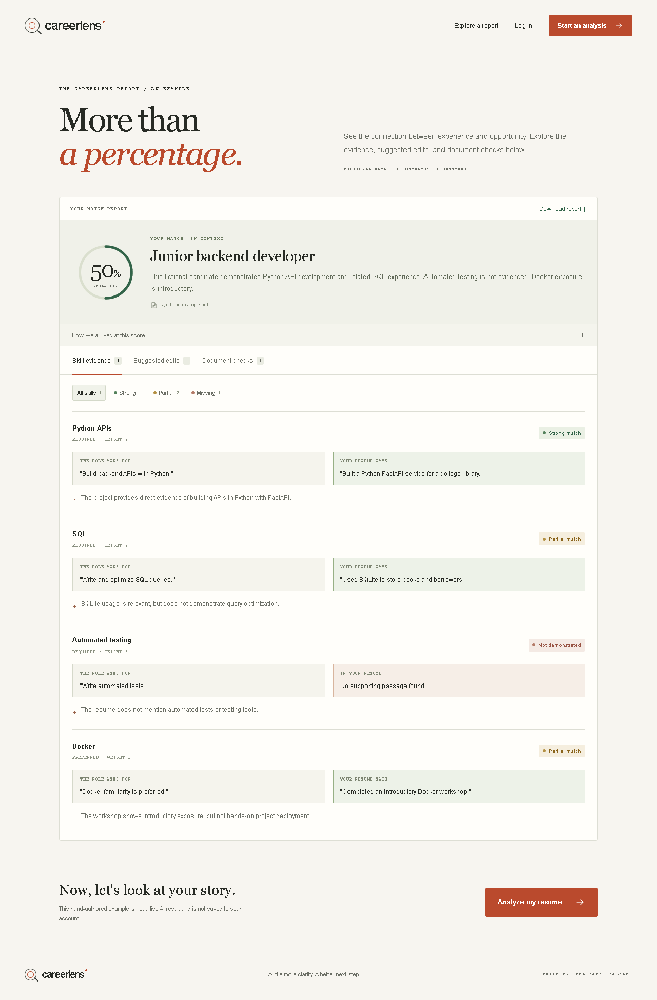
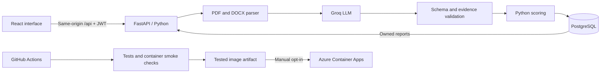

# CareerLens

**An evidence-backed resume and job matching application built with Python and an LLM.**

Upload a resume, add a job description, and inspect the passages behind strong, partial, and missing skill matches. CareerLens combines model-generated assessments with schema validation, quotation checks, and a transparent Python scoring rubric.

This is a portfolio application demonstrating backend engineering, LLM integration and evaluation, containerization, and a gated cloud delivery workflow. It does not train a model or predict hiring outcomes.



## What works

- JWT authentication with Argon2 password hashing and account-scoped reports.
- Bounded PDF/DOCX parsing, with no original uploads retained.
- Groq-powered semantic matching, requirement quotations, resume evidence, and suggested rewrites.
- Python-side response validation, quotation verification, duplicate-skill rejection, and checks against invented numeric metrics in rewrites.
- An inspectable weighted fit score; basic document text checks, without ATS certification claims.
- A responsive report UI with match filters, keyboard-accessible tabs, JSON export, saved history, report deletion, and password-confirmed account deletion.
- A clearly labelled fictional sample at `/sample`.
- Versioned prompts, response timing/token metadata, a synthetic evaluation dataset, a keyword baseline, and opt-in live/replay runners.
- A nonroot multi-stage Docker image serving React and FastAPI together, with PostgreSQL in Docker Compose.
- Automated Python tests, browser tests, migration checks, frontend checks, and a gated image delivery workflow.
- Azure Container Apps infrastructure as code, disabled by default.

## Start the full application

Prerequisites: Docker Engine with Compose v2. Source development additionally needs Python 3.11+ and Node.js 22.12+.

From the repository root:

```bash
python scripts/setup_local.py
docker compose up --build --wait
```

Open **http://localhost:8080**. The sample works without a provider key. Create your own account to explore the workspace.

The setup script generates an ignored root `.env` without overwriting an existing file. Add your **Groq Free-plan** key to its `GROQ_API_KEY` entry to enable live analysis, then recreate the app:

```bash
docker compose up -d --force-recreate app
```

Do not put API keys in React/Vite settings. Do not add a payment method or upgrade the provider plan just to run this demo.

On this development machine Docker Engine was installed in Ubuntu WSL2 rather than Docker Desktop. From Windows PowerShell, use:

```powershell
wsl -d Ubuntu -u root -- docker compose --project-directory /mnt/d/CareerLens up --build
```

Keep that WSL terminal open during the preview so the distro stays active. Use that same prefix for Compose commands on this machine. On other systems with Docker available directly, the shorter standard commands work.

### Stop and preserve data

```bash
docker compose down
```

The named PostgreSQL volume persists across ordinary restarts. Deleting it with `down --volumes` permanently removes local accounts and reports; use that only when you deliberately want a fresh database.

## Architecture



One production image serves both the frontend and API, avoiding separate CORS configuration in the container/cloud setup. Local Vite development can still use separate frontend/backend processes.

[Architecture and tradeoffs](docs/architecture.md) explain authentication, quotas, data lifecycle, logging, limitations, and migration compatibility.

## AI engineering and evaluation

The LLM extracts requirements and classifies evidence. Python checks the response and calculates:

`score = round(100 * sum(requirement_weight * match_value) / sum(requirement_weight))`

Required skills weigh 2; preferred skills weigh 1. Strong = 1, partial = 0.5, missing = 0.

The model can still misunderstand evidence, overlook requirements, or suggest an inaccurate rewrite. Valid quotations are a provenance check, not proof that an assessment is correct.

The evaluation set contains **12 synthetic cases and 25 manually labelled requirements**, including semantic paraphrases, negation, related experience, preferred skills, transferable skills, and prompt injection.

The committed **keyword baseline** scores **44% label accuracy** on this challenge set. It receives oracle requirements, so its extraction metrics are not comparable to an end-to-end model. A real **Qwen 3.8 27B** run scored **84% label accuracy**, macro F1 **0.7202**, with 12/12 valid responses and score MAE **8 points**. Partial evidence was the main weakness. These are small synthetic development-set measurements, not general accuracy or hiring claims. [Results and limitations](docs/verification.md).

From `backend`:

```bash
python -m evaluation.run --mode baseline --output evaluation/results/baseline.json
python -m evaluation.run --mode live --confirm-free-plan --max-cases 2 --output evaluation/results/live-small.json
```

Start with two live cases, inspect the results, then evaluate the full set. There are no automatic provider retries. [Evaluation methodology and metrics](backend/evaluation/README.md).

## Verification

With the full container stack running:

```bash
python scripts/smoke.py
cd frontend
npm ci
npx playwright install chromium
npm run test:e2e
```

The smoke script checks the real database-backed account lifecycle and cleans up its account. Browser tests cover desktop/mobile layouts, example interactions, keyboard report tabs, export, login, form reset, and account deletion. They make no AI calls.

An explicitly opted-in live smoke check is available with `python scripts/smoke.py --live-analysis` using the backend Python environment. It sends one fictional PDF to the configured provider, verifies a saved report, and deletes its report/account. This check passed locally, alongside **53 Python tests (93% coverage)** and **six real browser tests**. It is deliberately excluded from routine CI.

From `backend` with its development dependencies installed:

```bash
python -m pip install -r requirements-dev.txt
python -m ruff check --select F .
python -m pytest -q --cov=. --cov-report=term-missing
```

From `frontend`:

```bash
npm run lint
npm run build
```

The dependency lock/constraints record the tested versions. [Verification record](docs/verification.md) distinguishes local checks from checks that require accounts or remote CI.

## CI/CD and cloud deployment

The GitHub Actions workflow checks Python code/tests, migration consistency on PostgreSQL, evaluation contracts, frontend lint/build, Bicep compilation, a real Compose smoke test, and browser tests.

**Ordinary pushes and pull requests do not publish images or deploy cloud resources.** A manual workflow dispatch on `main` can publish the same image artifact that passed the checks. Updating an existing Azure app additionally needs an explicitly enabled repository variable, an Azure GitHub environment, and OIDC configuration.

Azure Container Apps is the selected cloud target. The template defaults to `deployResources=false`, scales from 0 to 1 replica, uses managed HTTPS, and keeps persistent data in external PostgreSQL. No paid registry, Azure database, VM, or Log Analytics workspace is included.

[Azure setup, cost boundaries, deployment, rollback, and teardown](infra/azure/README.md).

A protected student/credit subscription is required for a no-spend cloud exercise. Scale-to-zero is not a universal zero-bill guarantee. No cloud resources are created as part of normal local development or verification.

## Source development without Docker

From `backend`:

```powershell
python -m venv venv
.\venv\Scripts\python.exe -m pip install -r requirements-dev.txt
# Fresh setup only: preserve an existing .env.
Copy-Item .env.example .env
```

Generate a strong secret with `python -c "import secrets; print(secrets.token_urlsafe(48))"` and set `JWT_SECRET` in `backend/.env`. Use `DATABASE_URL=sqlite:///./careerlens.db` for a fresh local database. Set `GROQ_API_KEY` there for native development/evaluation.

```powershell
.\venv\Scripts\python.exe -m alembic upgrade head
.\venv\Scripts\python.exe -m uvicorn main:app --reload
```

From `frontend`, in another terminal:

```powershell
npm.cmd ci
npm.cmd run dev
```

Open http://localhost:5173; API docs are at http://localhost:8000/docs. On macOS/Linux use `venv/bin/python` and `npm`.

**Existing database:** back up and compare the schema before adopting migrations. Only if the initial tables already match migration 0001 should you use `alembic stamp 0001`, followed by `alembic upgrade head`. Never blindly stamp or reset a populated database.

## Configuration

| Setting | Purpose |
|---|---|
| Root `.env` | Compose secrets and optional Groq key |
| `backend/.env` | Native backend development and evaluation |
| `DATABASE_URL` | PostgreSQL in containers/cloud; SQLite supported locally |
| `JWT_SECRET` | Long random signing secret |
| `GROQ_API_KEY` | Backend only; required for live AI |
| `GROQ_MODEL` | Default: `qwen/qwen3.8-27b` |
| `GROQ_MAX_COMPLETION_TOKENS` | Default: 2,200 to fit the verified Free-plan request budget |
| `ANALYSES_PER_DAY` | 5 provider attempts per user per UTC day |
| `GLOBAL_ANALYSES_PER_DAY` | 20 provider attempts across the demo per UTC day |
| `AUTH_REQUESTS_PER_MINUTE` | 20 auth attempts per client IP, per process |
| `API_PREFIX` | Empty natively; `/api` in the full image |
| `VITE_API_BASE_URL` | Local API URL; image builds use `/api` |

Failed provider attempts count against quota. Invalid uploads and missing configuration do not. Deleting reports does not restore quota.

Limits: 5 MiB files, 10 PDF pages, 18,000 extracted characters, 80-12,000 job-description characters, and 6 MiB total HTTP bodies. Scanned PDFs need external OCR; legacy `.doc` is unsupported.

## Data and limitations

The upload form explains that extracted text and job descriptions go to Groq. CareerLens discards original uploads but stores extracted text and results until deletion. Users can remove reports or their entire account. Provider-side handling and database backups have separate policies.

Retention cleanup is explicit and preview-first:

```bash
python -m maintenance --older-than-days 30
# Only after reviewing the preview:
python -m maintenance --older-than-days 30 --apply
```

No automatic 30-day deletion is promised. Authentication currently has no email verification, password recovery, or refresh tokens. The document checks are text heuristics, not ATS compatibility tests. The synthetic evaluation does not justify hiring or shortlisting claims.

## Project guide

- [Frontend development and browser checks](frontend/README.md)
- [Architecture and decisions](docs/architecture.md)
- [AI evaluation](backend/evaluation/README.md)
- [Verification evidence](docs/verification.md)
- [Azure deployment exercise](infra/azure/README.md)
