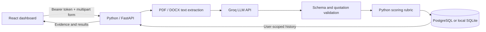

# CareerLens

An LLM-powered resume and job matching application built with Python, FastAPI, React, and SQLAlchemy. It explains matches with quotations from the resume instead of showing an unexplained keyword score.

This repository contains a working first implementation. It is not yet a published service, and live-model quality has not been benchmarked.

## Implemented

- Registration and login with Argon2 password hashing and expiring JWTs.
- Protected dashboard and API endpoints with account-scoped history.
- In-memory PDF/DOCX text extraction; uploaded originals are discarded.
- Groq-powered semantic skill assessments: strong, partial, or missing.
- Pydantic validation of model responses and verification that cited quotations occur in the submitted documents.
- Grounded rewrite prompts, transparent weighted scoring, and basic document text checks.
- Saved analysis retrieval and deletion, including stored resume text and job description.
- A public, hand-authored fictional sample at `/sample`, requiring neither registration nor an API key.
- SQLite for local development; PostgreSQL/Neon support for deployment.
- Alembic migrations, backend tests, frontend lint/build checks, GitHub Actions, and a backend Dockerfile.

## Architecture



The backend calls Groq directly through HTTPX. Model JSON mode guarantees neither schema compliance nor factual correctness, so the application separately validates the schema and checks quotations. No model is trained in this repository.

## How the score works

Required skills have weight **2**, preferred skills weight **1**. A strong match earns **1**, a partial match **0.5**, and a missing match **0**.

`score = round(100 * sum(weight * match_value) / sum(weight))`

The LLM extracts requirements and assigns match labels; Python calculates the percentage. The result is an estimate over extracted requirements, not a hiring probability. The model may overlook requirements or make incorrect assessments despite valid quotations. Rewrites must be reviewed for factual accuracy.

Document checks look for common headings and an email address in extracted text. They do not analyze visual formatting or certify compatibility with any ATS.

## Run locally

Prerequisites: Python 3.11+ and Node.js 22.12+.

From the repository root, in PowerShell:

```powershell
cd backend
python -m venv venv
.\venv\Scripts\python.exe -m pip install -r requirements-dev.txt
# For a fresh setup only; preserve an existing .env.
Copy-Item .env.example .env
.\venv\Scripts\python.exe -c "import secrets; print(secrets.token_urlsafe(48))"
```

Edit `backend/.env`:

- Replace `JWT_SECRET` with the generated secret.
- Keep `DATABASE_URL=sqlite:///./careerlens.db` for a local database, or use a PostgreSQL connection string.
- Set `GROQ_API_KEY` to your own Groq Free-plan key to enable live analysis. Keep it on the backend only.
- `GROQ_MODEL` is configurable; the default is `llama-3.3-70b-versatile`.

Then, **from the backend directory**:

```powershell
.\venv\Scripts\python.exe -m alembic upgrade head
.\venv\Scripts\python.exe -m uvicorn main:app --reload
```

In a second terminal, from the repository root:

```powershell
cd frontend
npm.cmd ci
# Optional: copy .env.example to .env for a fresh setup.
npm.cmd run dev
```

Frontend: <http://localhost:5173> | API docs: <http://localhost:8000/docs>

On macOS/Linux, use `python3 -m venv venv`, `venv/bin/python` instead of the Windows Python path, and `npm` instead of `npm.cmd`.

Existing databases created manually need care: do not blindly stamp a populated database. Back it up and compare its schema with `migrations/versions/0001_initial.py`. Only if the initial schema already matches, mark that baseline with `alembic stamp 0001`, then run `alembic upgrade head`. An empty database should always use `upgrade head` directly.

## Configuration and limits

| Variable | Default / purpose |
|---|---|
| `DATABASE_URL` | Required; SQLite locally or PostgreSQL in deployment |
| `JWT_SECRET` | Required; a long random secret |
| `GROQ_API_KEY` | Required only for live AI calls |
| `GROQ_MODEL` | `llama-3.3-70b-versatile` |
| `CORS_ORIGINS` | Local Vite origins, comma-separated |
| `ANALYSES_PER_DAY` | 5 provider attempts per account per UTC day |
| `GLOBAL_ANALYSES_PER_DAY` | 20 provider attempts for the entire demo per UTC day |
| `VITE_API_BASE_URL` | Frontend setting; defaults to `http://localhost:8000` |

Upload limits: 5 MB, PDF up to 10 pages, extracted text up to 18,000 characters. Job descriptions: 80-12,000 characters. Image-only/scanned PDFs need external OCR and are rejected when insufficient text is found. Legacy `.doc` files are unsupported.

Provider failures consume an attempt; invalid uploads and missing API configuration do not. Deleting a result does not refund attempts. The service runs one provider call at a time **per process**. Run one backend worker/replica for this demo; distributed quota reservation is not implemented.

There are no automatic retries or fallback calls to paid providers. Keep your provider account on a free plan. Application quotas do not enforce a cloud-provider billing cap.

## API

| Method | Path | Purpose |
|---|---|---|
| POST | `/auth/register` | Create account |
| POST | `/auth/login` | Get bearer token |
| GET | `/auth/me` | Verify session |
| POST | `/analyses` | Multipart fields: `resume`, `job_title`, `job_description` |
| GET | `/analyses` | Latest 50 analyses for the current user |
| GET | `/analyses/{id}` | Retrieve owned analysis |
| DELETE | `/analyses/{id}` | Delete owned analysis and its document inputs |
| GET | `/health` | Liveness |
| GET | `/health/database` | Database connectivity |

All analysis endpoints require a bearer token. Another user's analysis returns 404.

## Verification

From `backend`:

```powershell
.\venv\Scripts\python.exe -m pytest -q
```

Tests use isolated in-memory SQLite and mocked AI responses. They never use the configured database or make live LLM calls. Coverage includes token rejection, ownership, parsing failures, evidence validation, scoring, provider errors, deletion, and quotas. These are software correctness checks, not an AI accuracy benchmark.

From `frontend`:

```powershell
npm.cmd run lint
npm.cmd run build
```

GitHub Actions runs those checks and verifies migration/model consistency.

## Deployment preparation

The intended no-spend demo layout is a static React host, a free Python web service, Neon Free PostgreSQL, and Groq Free. Free plans have quotas and can change; sleeping backends can make the first request slow. No cloud resources are provisioned by this repository.

- Frontend root: `frontend`; build: `npm run build`; output: `dist`.
- Configure `VITE_API_BASE_URL` before building. `frontend/vercel.json` supplies SPA routing for Vercel.
- Backend root: `backend`; install `requirements.txt`; start with `alembic upgrade head && uvicorn main:app --host 0.0.0.0 --port $PORT --workers 1`.
- Set backend environment variables and the exact deployed frontend origin in `CORS_ORIGINS`.
- Use PostgreSQL in deployment, since free hosts may discard local SQLite files on restart.
- Alternatively build `backend/Dockerfile` with the backend directory as build context. Do not put secrets in the image.

## Privacy and remaining work

The upload form explains that extracted text and the job description go to Groq. CareerLens stores that text and results until the user deletes the analysis; original upload bytes are not saved. Quota records retain only a user ID and timestamp. Provider-side handling follows Groq's policies.

Before broader public use, add authentication abuse protection, request-body limits at the host/proxy, and a reviewed retention/account-deletion policy. Session tokens currently use browser sessionStorage. Deployment should use HTTPS.

Next portfolio milestones: a curated synthetic evaluation dataset, measured model quality, browser interaction tests, screenshots, a short demo recording, and an optional reproducible AWS/Azure deployment exercise. Do not claim benchmark accuracy or cloud deployment until measured or completed.

## References

- [Groq JSON and structured output behavior](https://console.groq.com/docs/structured-outputs)
- [PyMuPDF text extraction](https://pymupdf.readthedocs.io/en/latest/recipes-text.html)
- [Alembic migrations](https://alembic.sqlalchemy.org/en/latest/tutorial.html)
